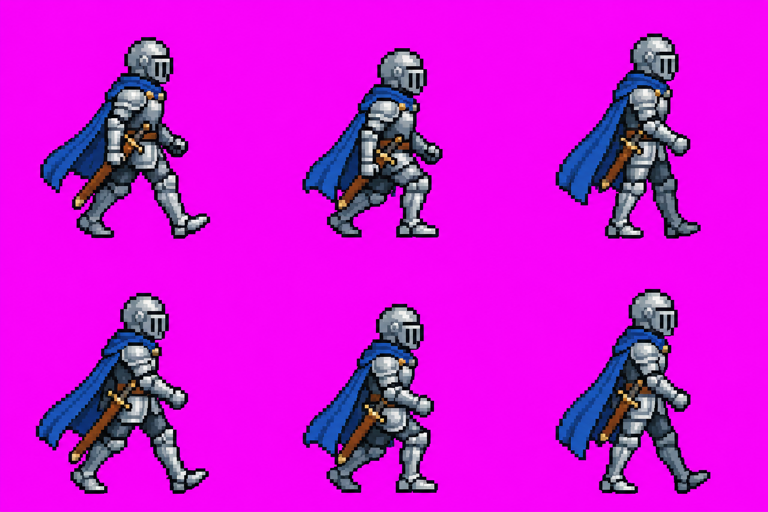
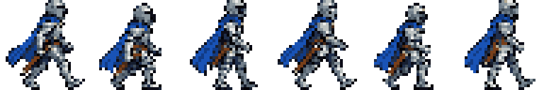

# align-sprites

Normalize AI-generated sprites and tiles so they work in **Godot 4**, **GDevelop 5** and **Kaplay**: fixed cell sizes, one shared scale, feet-aligned frames, a true pixel grid and clean transparency. Everything runs in your browser; images are never uploaded.

**→ https://alex-roc.github.io/align-sprites/** · [Guide](docs/README.md) · [Guía en español](docs/es.md)

| AI output | After align-sprites |
|---|---|
|  |  |

## What it does

- **Sprite sheets and single characters**: removes the background (chroma key with edge matting, or flood from the borders for white backgrounds), finds every frame (auto, grid or single), recovers the real pixel grid of "fake" AI pixel art, resizes every character of a batch to the **same height**, shares one palette, and packs the frames into fixed cells (multiples of 32) with the **feet on the same line**.
- **Export**: Godot 4 (`SpriteFrames .tres` + `AnimatedSprite2D .tscn` with the origin at the feet), GDevelop 5 (one PNG per frame + origin point), Kaplay (`loadSprite` snippet), generic (Aseprite JSON).
- **Tiles**: turns an AI tile sheet into exact T×T tiles (Godot TileSet, Tiled `.tsx`), and composes terrain transitions from two seamless textures (blob 47 with Godot terrains, or dual-grid 16).
- **Prompts**: templates (en/es) and a guide grid image to generate whole animations with Gemini or ChatGPT.

*Español:* herramienta web gratuita para normalizar sprites y tiles generados con IA (Gemini, ChatGPT…) y usarlos en Godot, GDevelop y Kaplay: celdas fijas, una sola escala, pies alineados y cuadrícula de píxeles real. Ver la [guía](docs/es.md).

## Development

```sh
pnpm install
pnpm dev               # http://localhost:5173/align-sprites/
pnpm test              # Vitest: core with synthetic fixtures and real AI samples
pnpm test:godot        # headless Godot 4 loads the exported SpriteFrames (skips if Godot is missing)
pnpm test:godot:tiles  # headless Godot 4 checks TileSet terrains with set_cells_terrain_connect
pnpm build
node scripts/run-samples.ts   # process samples/ → samples/out/ for visual checks
```

Architecture: [dev-docs/architecture.md](dev-docs/architecture.md). Sample sheets: `samples/real/` (real course assets) and `samples/codex/` (generated with our prompts; defects documented in its README).

## License

GPL-3.0-or-later. Includes the [unfake.js](https://github.com/jenissimo/unfake.js) WASM core (MIT), which bundles imagequant (GPL-3.0). Made by Alex Ojeda Copa · [Lab TecnoSocial](https://labtecnosocial.org).
