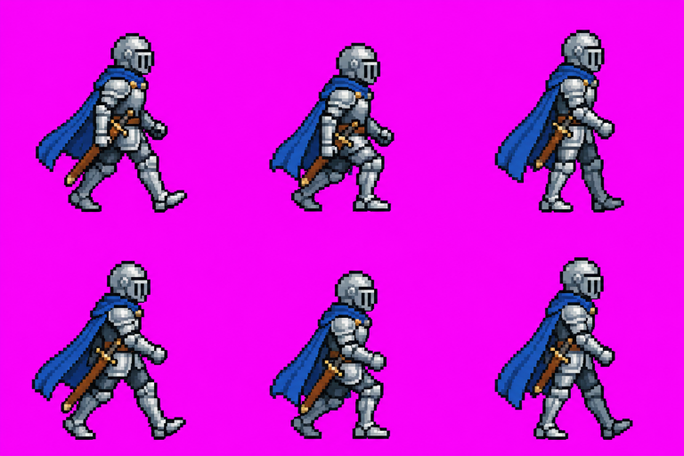
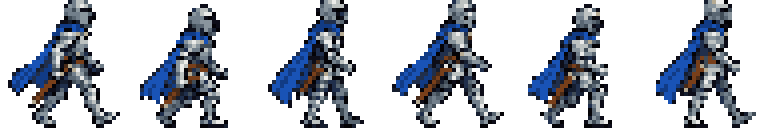
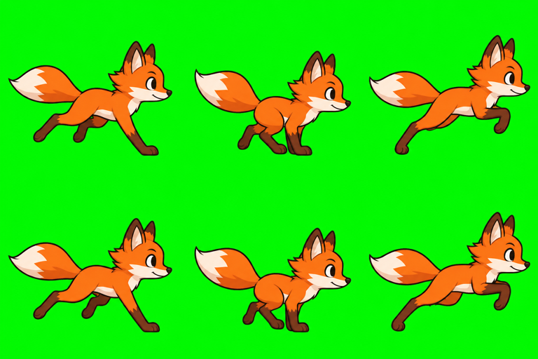
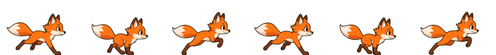

# align-sprites guide

> The up-to-date, interactive guide lives in the app: **https://alex-roc.github.io/align-sprites/#/guide**. This file is a reference copy.

**[Open the tool →](https://alex-roc.github.io/align-sprites/)** · [Guía en español](es.md)

AI image models (Gemini / Nano Banana, ChatGPT…) draw nice characters, but their sprite sheets break in game engines: frames of different sizes, characters that jump around between frames, a different scale on every image, "fake" pixel art (blurry ×8 blocks on an irregular grid) and a coloured background instead of transparency. align-sprites fixes that in your browser. Your images are never uploaded anywhere.

| AI output | After align-sprites (32 px tall, 16 colours, 32×32 frames) |
|---|---|
|  |  |
|  |  |

## 1. Make the image with AI

Open the **Make with AI** tab:

1. Describe the character and the action (walk, run, idle, attack, jump…), the number of frames and columns.
2. Copy the prompt and download the **guide image** (a magenta grid with a feet line).
3. In Gemini or ChatGPT, paste the prompt and attach the guide. If you already have a good character, attach it too as a reference: generating the animation from one reference image is what keeps the character consistent. The AI tends to copy the detail level of the reference rather than the height you asked for; that is fine, you choose the final size in the tool.
4. Download the result.

Tips:

- Ask for the **whole animation in one image**. Frames generated one by one never match.
- Use the **green key** if your character is pink, purple or magenta.
- Smaller characters (16–48 art pixels tall) are easier for the AI to keep consistent.
- The AI will not follow the guide exactly (frame count, feet line, size). That is fine: the tool fixes it.
- Some defects only you can fix: repeated poses and a character that changes between frames. Generate again, with a reference image.

## 2. Normalize

Open the **Sprites** tab and drop one or more images. For each one the tool detects whether it is a **sprite sheet** (several frames) or a **single sprite** (one drawing). Correct it under **Image type** if it guessed wrong.

The settings follow the order you think in: art style, sprite size, frame size, frames, animations. Colours, background and advanced stay folded. With several images the column splits into settings for all images and for only the selected one.

- **Art style**: *Pixel art* finds the real pixel grid, removes the AI blur, keeps hard edges. *Cartoon* resizes smooth art with clean antialiased edges.
- **Sprite size**: the height of the drawing, in px. Presets: Original, 8, 16, 32, 64, 96, 128, or Other. It also shows the size in game tiles (set the game tile in the Kit tab). Every image in the batch gets the same height, so your player and your enemy have the same scale. A relative size (1.5 for a boss) goes on top. Choose a height smaller than what the AI drew: enlarging pixel art makes the pixels uneven.
- **Frame size**: the sprite is the drawing; the frame is the canvas each frame occupies, with the feet on one line. *Automatic* picks the smallest multiple of 32 where everything fits. *Custom* lets you type width and height (steps of 8 px, never below what fits) and the space under the feet. Multiples of 32 work well in most engines.
- **Frames** (sprite sheets): *Automatic* finds each frame, or *Grid* cuts rows × columns. In the **Original** view, **Edit boxes** lets you draw, move and resize the frame boxes by hand.
- **Animations**: name, frames such as `0-5` or `0,2,4-6`, FPS and loop. **Mirror** flips an animation, and **Create mirrored copy** adds the mirrored version as a new animation.
- **Colours**: *Original colours*, a ready palette (PICO-8, Sweetie 16, Endesga 32, Game Boy), a palette *from an image*, or *Reduce to N colours*. The palette is shared by every image and by your tiles. Fixed palettes only work with pixel art.
- **Colour variants**: click a colour to change it, then **Duplicate as colour variant** to keep both versions (enemies, teams).
- **Background**: Auto (the most common border colour). *Everywhere (chroma key)* for magenta and green; *Only from the edges* for white backgrounds (it also clears enclosed pockets of flat white, like the gap between the feet). Lower the tolerance if part of the character disappears.

### Single sprites and sprite sheets

A single sprite has no animations and has the views **Sprite** and **Original**. A sprite sheet has **Animation**, **Final sheet** and **Original**. With several images, **All together** puts every image on one ground line at the same zoom: the proof that they share a scale.

### Fix frames by hand

The frame editor, under the frame strip, acts on the selected frame: move left or right, duplicate, remove from the animation, nudge 1 px. Shortcuts: `[` and `]` move the frame, `D` duplicates it, `Delete` removes it, `Shift` + arrows nudge it, `0` resets the nudge. When the AI repeats a pose, the tool says so ("Frame 4 repeats frame 1") and **Remove duplicates** removes them.

## 3. Use it in your engine

Under the stage, choose the engine and press **Download for …**. The ZIP has one folder per engine.

### Godot 4

1. Copy the folder `godot/<name>/` into your project (for example `res://characters/<name>/`).
2. Drag `<name>.tscn` into your scene: it is an `AnimatedSprite2D` whose **origin is at the feet**, with every animation ready (fps and loop included). A **single sprite** gives a `Sprite2D` scene instead.
3. Pixel art: the scene already uses *Nearest* filtering. For the whole project use *Project Settings → Rendering → Textures → Default Texture Filter = Nearest*.

You can also use only `<name>.tres` (a `SpriteFrames` resource) in your own `AnimatedSprite2D`, but the feet offset is in the `.tscn`. If Godot shows an error the first time, wait for the import to finish or reload the project.

### GDevelop 5

Two ways to add each animation (pick one):

- **Frames**: create a **Sprite** object, add an animation, click *Add images* and select all the PNGs of `gdevelop/<name>/<animation>/` at once.
- **Piskel spritesheet**: add an animation, open it with *Edit with Piskel*, then *Import*, pick `spritesheets/<animation>.png` and *Import as spritesheet* with your frame size.

Then set the time between frames to `1 / fps` and the loop. In *Edit points* (the Points editor), set the **Origin** point to the value in the README (the feet) for all frames. A **single sprite** is one PNG, `gdevelop/<name>/<name>.png`. Pixel art: in the project properties set the scale mode to *Nearest (no antialiasing)*. (Menu names follow GDevelop 5 as we last saw it; the README in the ZIP has the same steps.)

### Kaplay

`kaplay/<name>.png` plus `kaplay/<name>.js` with the `loadSprite(...)` call (`sliceX`, `sliceY`, `anims`; each animation starts at `row × columns`). Use `anchor("bot")` so the feet are the origin, and `kaplay({ crisp: true, texFilter: "nearest" })` for pixel art. A single sprite is a plain `loadSprite(name, png)`.

### Other engines

`generic/<name>.png` + `<name>.json` in Aseprite's format, plus one PNG per frame. Phaser reads it as an Aseprite atlas, Unity slices the PNG with *Grid By Cell Size*, and Defold and Construct can import the per-frame PNGs. We know these engines less well: check their documentation. Any engine that slices by frame size works: animation `k` is row `k`, frame `i` is column `i`, origin at the feet.

## 4. Tiles

The **Tiles** tab has two tools.

### Tile sheet (clean up an AI tileset)

1. Add one image with several tiles laid out in rows and columns (try *Andean mountains tileset*).
2. Pick the **tile size** (8 to 128 px, or your own). The grid is detected from the empty gaps between tiles; if the cut lines look wrong, untick *Detect columns and rows automatically* and type the columns and rows.
3. Every tile is resampled to exactly that size, the background is removed, and empty tiles are crossed out and left out of the tile set.
4. Choose a format (Godot 4, Tiled / GDevelop, PNG) or all formats and download.

### Terrain transitions (grass → dirt, and so on)

1. Add texture **A** (base terrain) and texture **B** (painted over A). Both should be square and seamless. Tick *No texture B: paint A over transparent* to make an overlay layer.
2. Choose the layout: **Blob 47 (Godot)** or **Dual 16 (GDevelop)**. Tune the edge style. The **test map** shows a random map built with your tiles; press *Shuffle map* to check that they connect everywhere. *Seams in A* and *Seams in B* tell you whether each texture repeats cleanly.
3. **Download ZIP**: the atlas PNG, a Godot `TileSet` `.tres` with the terrain data filled in, and a README with the tile table.

### Using the tiles in your engine

- **Godot 4**: copy the folder `godot/<name>/` into your project and assign the `.tres` to a `TileMapLayer`. For Blob 47, open the *TileMap* panel, choose the **Terrains** tab and paint. Dual 16 is made for the *TileMapDual* addon.
- **GDevelop 5**: use the **Tilemap** object with the `.tsx` (Tiled) and the atlas PNG. The Dual 16 atlas has no terrain data: paint it by hand using the README table.
- **Tiled / LDtk**: open the `.tsx` as a tileset.

## 5. Kit

The **Kit** tab joins your sprites and tiles so they share one scale.

- **Game tile size**: 16, 32, 48 or 64 px, the grid your game is built on. Sprite heights are shown in tiles, and a tile set with another size gets a warning with a button to fix it.
- **Shared palette**: the same palette as Colours in Sprites. A fixed palette is also applied to your tiles.
- **Preview at real scale**: your sprites standing on a row of your tiles. If it looks right here, it will in your game.
- **Download the kit for …**: one ZIP per engine with `sprites/`, `tiles/` and a `README.txt` that lists every size and the palette.

## Troubleshooting

| Problem | Fix |
|---|---|
| Detected as the wrong type | Change **Image type**: sprite sheet or single sprite. |
| Wrong number of frames | Use *Grid* with the rows × columns of the image, raise the tolerance if specks of background became frames, or draw the boxes with **Edit boxes**. |
| The jump comes out bigger than the other animations | Most of its frames are crouched: press **Measure the tallest frames** and compare in **All together**; adjust the **Relative size** if needed. |
| A part of the character disappears | The background removal took it: lower the tolerance, or use *Only from the edges*. Next time, use the green key. |
| A frame is cut by the frame edge | Use a bigger frame size or *Automatic*, or a smaller sprite size. |
| Player and enemy have different sizes | Pick one common sprite size. |
| "The sprite is shrunk a lot" | The AI drew the character much bigger than your sprite size: ask for a smaller one (around 32 art pixels). |
| "No clear pixel grid was found" | The image is not pixel art (use *Cartoon*) or it is at its original size. |
| Frames repeat or the character changes | The AI repeated a pose: **Remove duplicates**, or regenerate with a reference image. |
| The feet jump between frames | Nudge the frame in the frame editor (`Shift` + arrows). |
| The character faces the wrong way | **Create mirrored copy** on the animation. |
| Pixel art looks blurry in the engine | Nearest filtering: *Default Texture Filter* (Godot), *Scale mode* (GDevelop), `texFilter: "nearest"` (Kaplay). |
| Sprites and tiles do not fit together | Set the game tile size in the Kit tab and use it for your tiles. |

## Credits

Built by Alex Ojeda Copa, Lab TecnoSocial.

Pixel-grid detection uses [unfake.js](https://github.com/jenissimo/unfake.js) by Eugeniy Smirnov, under the MIT licence ([licence notice](https://github.com/jenissimo/unfake.js/blob/main/LICENSE)).

align-sprites is free software under the [GPL-3.0](https://github.com/alex-roc/align-sprites/blob/main/LICENSE) licence.
