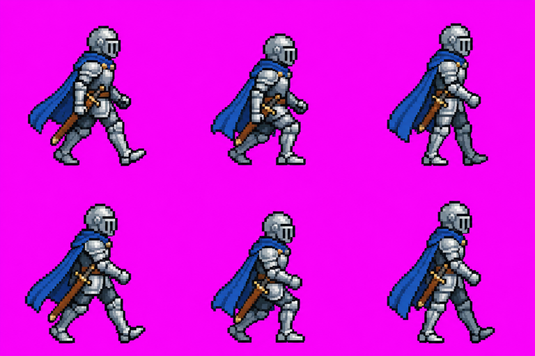
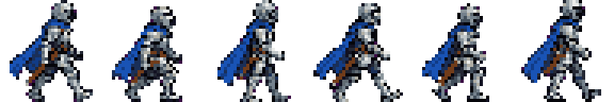
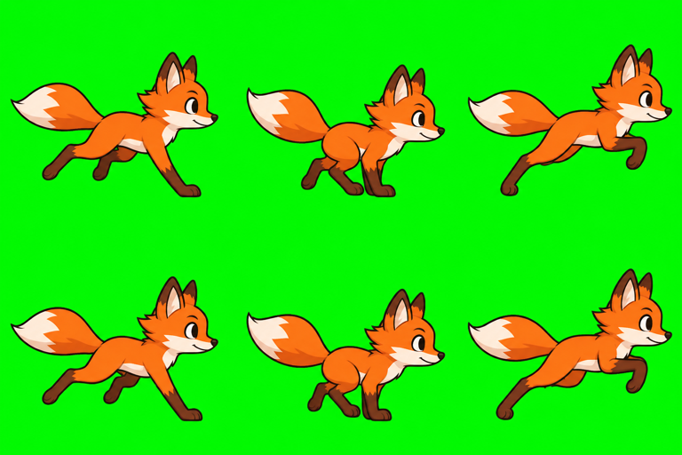
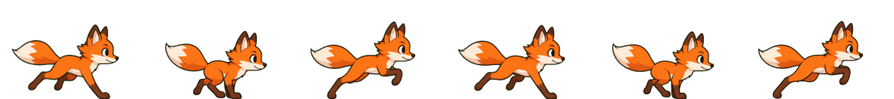

# Guía de align-sprites

**[Abrir la herramienta →](https://alex-roc.github.io/align-sprites/)** · [Guide in English](README.md)

Los modelos de imagen (Gemini / Nano Banana, ChatGPT…) dibujan buenos personajes, pero sus hojas de sprites fallan en los motores de juego. Los frames salen de tamaños distintos y el personaje salta de un frame a otro. Cada imagen trae otra escala, el pixel art es «falso» (bloques ×8 borrosos sobre una cuadrícula irregular) y el fondo viene de color en vez de transparente. align-sprites lo corrige en tu navegador. Tus imágenes no se suben a ningún lado.

| Lo que da la IA | Después de align-sprites (32 px de alto, 16 colores, celdas de 32×32) |
|---|---|
|  |  |
|  |  |

## 1. Generar con IA

Abre la pestaña **Generar con IA**:

1. Describe el personaje y la acción (caminar, correr, reposo, ataque, salto…), el número de frames y de columnas.
2. Copia el prompt y descarga la **imagen guía**: una cuadrícula magenta con la línea de los pies.
3. En Gemini o ChatGPT pega el prompt y adjunta la guía. Si ya tienes un buen personaje, adjúntalo también como referencia: lo que mantiene la coherencia del personaje es generar la animación a partir de una imagen de referencia.
4. Descarga el resultado.

Consejos:

- Pide **toda la animación en una sola imagen**. Los frames generados uno por uno nunca coinciden.
- Usa la **clave verde** si tu personaje es rosado, morado o magenta.
- A la IA le cuesta menos mantener coherentes los personajes pequeños, de 16 a 48 píxeles de arte de alto.
- La IA no seguirá la guía al pie de la letra (número de frames, línea de pies, tamaño). No importa: la herramienta lo corrige.

## 2. Normalizar

Abre la pestaña **Sprites** y suelta una o varias imágenes.

**Ajustes para todo el lote.** Son compartidos, así todos los personajes quedan a la misma escala:

- **Estilo de arte**: *Pixel art* encuentra la cuadrícula real de píxeles, quita el desenfoque de la IA, mantiene los bordes duros y puede limitar la paleta. *Cartoon / vectorial* redimensiona arte suave con bordes limpios y antialiasing.
- **Tamaño de celda**: *Auto* elige el menor múltiplo de 32 donde quepan todos los frames. También puedes fijar el ancho y el alto (32, 64, 96, 128…). Un personaje suele ser más alto que ancho, por ejemplo 64×96.
- **Altura del personaje**: al activarla, cada personaje del lote se redimensiona a esa altura en píxeles. Esto arregla el problema de que el jugador y el enemigo salgan de tamaños distintos. Un personaje suelto grande (una imagen de tipo *Personaje suelto*) se redimensiona igual.
- **Colores máximos** (pixel art): una paleta compartida por todo el lote, por ejemplo de 16 o 32 colores.

**Ajustes por imagen**: el fondo (casi siempre *Auto*), la detección de frames (*Auto*, *Cuadrícula* de filas × columnas o *Un solo personaje*), las animaciones (nombre, frames como `0-5`, fps y bucle) y el tamaño relativo (1.5 para un jefe).

**Resultado**: los frames detectados sobre la imagen original, la hoja final, una vista previa animada (papel cebolla, línea de pies y origen) y un diagnóstico con advertencias, por ejemplo «se recortó contenido: usa una celda más grande o Auto».

## 3. Usarlo en tu motor

**Descargar ZIP** trae una carpeta por motor.

### Godot 4

1. Copia la carpeta `godot/<nombre>/` dentro de tu proyecto (por ejemplo, `res://personajes/<nombre>/`).
2. Arrastra `<nombre>.tscn` a tu escena. Es un `AnimatedSprite2D` con el **origen en los pies** y todas las animaciones listas, con sus fps y su bucle.
3. En pixel art, la escena ya usa el filtro *Nearest*. Para todo el proyecto: *Configuración del proyecto → Rendering → Textures → Default Texture Filter = Nearest*.

También puedes usar solo `<nombre>.tres` (un recurso `SpriteFrames`) en tu propio `AnimatedSprite2D`. Si Godot muestra un error la primera vez, espera a que termine la importación o vuelve a abrir el proyecto.

### GDevelop 5

GDevelop no importa hojas de sprites, así que el ZIP trae un PNG por frame en `gdevelop/<nombre>/<animación>/<animación>_00.png…`.

1. Crea un objeto **Sprite**, añade una animación y agrega todas sus imágenes a la vez (se ordenan por nombre).
2. Pon el tiempo entre frames en `1 / fps` y el *bucle* como indica el README.
3. En *Editar puntos*, fija el punto **Origen** en el valor del README (los pies) para que todas las animaciones queden alineadas.
4. En pixel art, en las propiedades del proyecto elige el modo de escalado *Nearest* (pixel art).

### Kaplay

`kaplay/<nombre>.png` y `kaplay/<nombre>.js` con la llamada `loadSprite(...)` (`sliceX`, `sliceY`, `anims`). Usa `anchor("bot")` para que el origen esté en los pies, y `kaplay({ crisp: true, texFilter: "nearest" })` en pixel art.

### Otros motores

`generic/<nombre>.png` con `<nombre>.json` en el formato de Aseprite (sirve para Phaser, los importadores de Unity, Defold…), más un PNG por frame.

## Problemas frecuentes

| Problema | Solución |
|---|---|
| El número de frames no es el correcto | Usa *Cuadrícula* con las filas × columnas de la imagen, o sube la tolerancia si unas manchas del fondo se convirtieron en frames. |
| Desaparece una parte del personaje | La quitó el borrado del fondo: baja la tolerancia o genera con la clave verde. En los fondos blancos se usa *flood* (solo desde los bordes) para que la ropa blanca sobreviva. |
| «Se recortó contenido» | Usa una celda más grande o *Auto*. Los personajes anchos (animales, slimes) necesitan celdas más anchas. |
| «Reducción grande» | La IA dibujó el personaje mucho más grande que tu altura objetivo. Pídele un personaje más pequeño (por ejemplo, de 32 píxeles de arte) y saldrá más nítido. |
| «No se encontró cuadrícula de píxeles» | La imagen no es pixel art (usa *Cartoon*) o ya está a su tamaño nativo. |
| Los frames se repiten o el personaje cambia | Eso viene de la IA: vuelve a generar adjuntando una imagen de referencia del personaje. |
